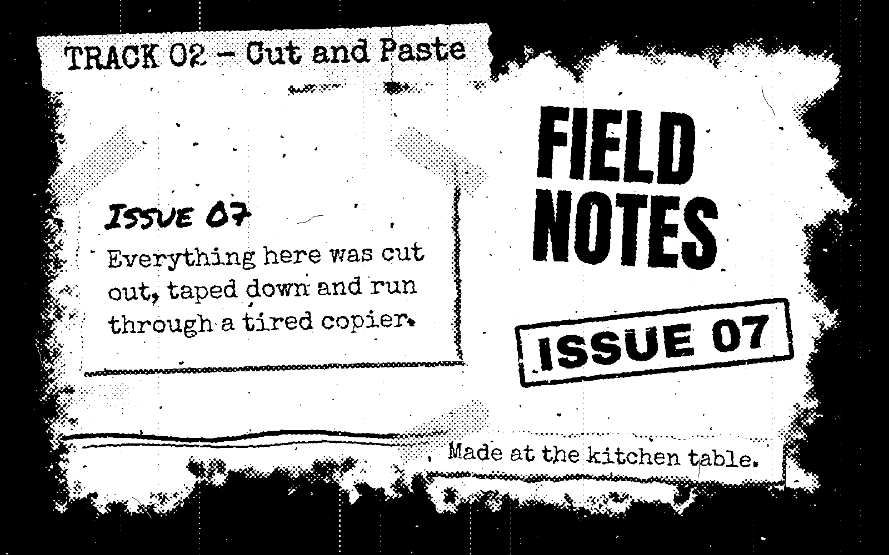
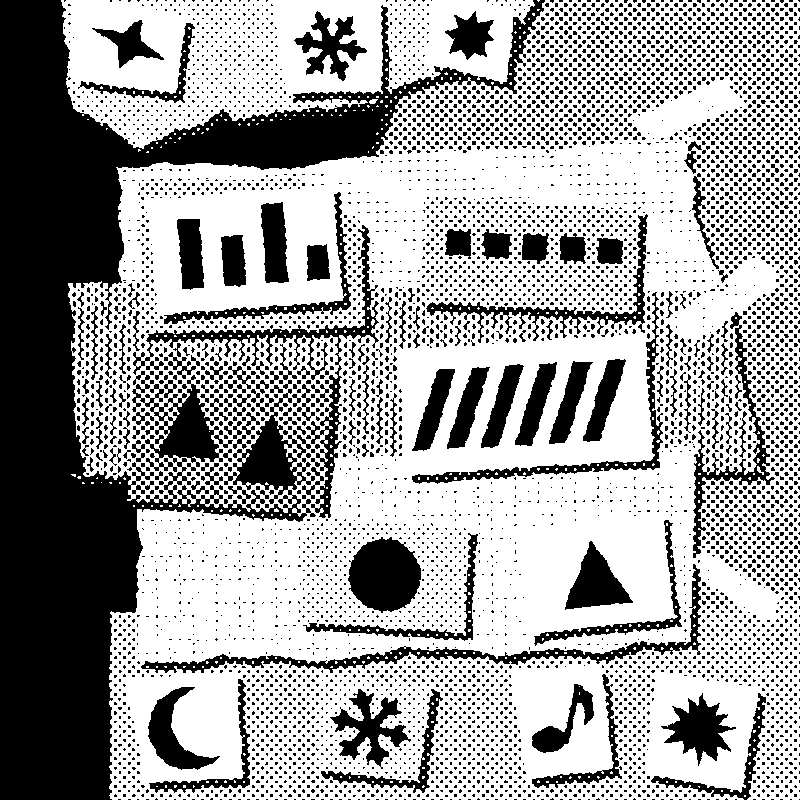

# printshop

printshop turns layouts into print-look images.
It makes photocopied zine pages, paper collages, ransom-note titles and animated SVGs that play inside GitHub.

<p align="center">
  
</p>

You write a layout as an HTML page, or as code.
printshop renders the layout in headless Chromium and runs the picture through a chain of small filter steps.
Then it encodes a small indexed PNG, and it runs checks over the result.
Every random feature comes from a named, seeded stream, so the same input and the same seed give the same image.

The code is plain JavaScript (ES modules) with JSDoc types.
It needs no build step.

## Contents

- [Install](#install)
- [Try the examples](#try-the-examples)
- [The command line](#the-command-line)
- [The two packs](#the-two-packs)
- [The examples](#the-examples)
- [How it works](#how-it-works)
- [More docs](#more-docs)
- [Develop](#develop)
- [License](#license)

## Install

Use printshop as an npm dependency from GitHub.
Pin it to a release tag.
The lockfile then records the exact commit.

<!-- docs-check: network -->
```sh
npm install github:tranbao0/printshop#v1.0.0 --ignore-scripts
npx playwright install --with-deps --only-shell chromium
```

The `--ignore-scripts` flag stops install scripts from running.
printshop needs none.
The flag also means that the install does not download a browser, so the second command does that.
On Linux, `--with-deps` installs the system libraries of Chromium and needs root rights.
Drop the flag if you have the libraries already.

You need Node.js 22.2.0 or newer.
The package installs the program `printshop` in `node_modules/.bin`.
Run it with `npx printshop`.

## Try the examples

The package ships its examples.
They are in `node_modules/@tranbao0/printshop/examples`.
Run these commands in the folder of your project.
Each command writes its image to the `out` folder.

```sh
npx printshop build node_modules/@tranbao0/printshop/examples/zine-page/page.html
npx printshop build node_modules/@tranbao0/printshop/examples/ransom-title/title.html
npx printshop build node_modules/@tranbao0/printshop/examples/collage/scene.js
```

Each command prints the result of the checks and the name of the file that it wrote.
The command exits with 1 if a check fails.

## The command line

The package has one program, `printshop`.
Run `printshop --help` for the list of commands.
Run `printshop <command> --help` for the options of one command.

```sh
npx printshop --help
npx printshop build --help
npx printshop new-style --help
npx printshop ref --help
```

### `printshop build <input>`

It builds an image from a layout and runs the checks of the pack.
The input is one of these:

- An HTML file.
  The page needs an element with the id `page`.
  The page sets the attribute `data-ready` on the body when it is ready to print.
- The layout of an example that is made in code, such as `examples/collage/scene.js`.
- With `--module`, a JavaScript file of your own whose default export is a build function.

The pack is the pack that names the file as one of its examples.
Otherwise it is the pack of `--pack`, or the zine pack.
Useful options are `--pack`, `--preset`, `--seed`, `--kind`, `--option key=value`, `--out` and `--verbose`.
The command never writes over the golden image of a pack.

### `printshop new-style <name>`

It copies the template of a pack into `packs/<name>` in your project.
The new pack builds its example and passes its own test as it is.
[Adding a style](docs/adding-a-style.md) takes you from here to a style of your own.

```sh
npx printshop new-style riso-test
npx printshop build packs/riso-test/example/page.html
```

### `printshop ref frames|register|trace`

These are the reference tools.
You use them before you build, to measure what you want to match.
[The process](docs/process.md) says how.

- `ref frames` makes a sheet of numbered frames from a video.
  It needs `ffmpeg` on `PATH`, or in the `FFMPEG` environment variable.
  Without `ffmpeg`, it says so and exits with 1.
- `ref register` finds the scale and the offset that match a screenshot to an image.
- `ref trace` takes the marks of one colour out of a registered screenshot and maps them into the coordinates of the image.

<!-- docs-check: ffmpeg -->
```sh
npx printshop ref frames reference.mp4
```

```sh
npx printshop ref register screenshot.png reference.png --out fit.json
npx printshop ref trace screenshot.png --fit fit.json
```

## The two packs

A style pack holds one look.
It has filter steps, presets, assets with their licenses, checks and examples.
printshop ships two packs.

### Zine

The zine pack lives in `packs/zine`.
It prints a layout as a cheap photocopy: a halftone screen, patches of weak toner, drum streaks, specks and hairs.

- The page parts: torn and cut paper, tape, track labels, worn stamps, burnt sheets and cut-out letter tiles.
- Six fonts with open licenses.
  Each font has its license file next to it.
- `ransomSvg`: an animated title.
  Each letter is its own cut-out piece, and the title plays entrance, flips, hops and rests with CSS.
  The file has no script and no external reference.
- One preset, `page`, for a page 1600 px wide.
- Checks for the size of the file, and for the number of colours.
  An animated title has a size budget too.

### Collage

The collage pack lives in `packs/collage`.
It builds a paper collage from pieces, and prints it with a halftone screen.

- Sheets and tiles with scissor-cut or torn edges, drop shadows, mats, tape, and motifs that lie flat on holding pieces.
- A scene model: a stack of pieces, pasted from the bottom up.
- One preset, `card`, for a picture 800 px wide.
- Checks that keep a collage honest: marks that are hidden or too near an edge, thin slivers of paper, a safety sheet that shows, gaps that a magenta probe finds, and gray papers that print alike.

The collage pack holds only general paper parts.
The pieces of a picture are yours.

## The examples

Each example is the input of a golden test, so the pictures below are the output of the current code.

| Example | Pack | Input | Image |
| --- | --- | --- | --- |
| A zine page | zine | `examples/zine-page/page.html` |  |
| An animated title | zine | `examples/ransom-title/title.html` |  |
| A paper collage | collage | `examples/collage/scene.js` |  |

The title is an SVG.
It plays on GitHub when you embed it with an `img` tag, as this page does.
`examples/ransom-title/title-still.png` is the still image of the same title.

## How it works

1. A layout is rendered.
   `src/core/render.js` opens the page in Chromium, sets the width, waits for `data-ready`, and takes a screenshot of the element `#page`.
   The page can mark areas as calm zones with `data-clean`, `data-soft` or `data-nospeck`, and can name boxes with `data-box`.
2. A chain of filter steps turns the screenshot into gray values and then into black and white.
   A step is a small object with a name, defaults and a `run` function.
   The core has the general steps: gray, contrast, calm zones, ink bleed, threshold and levels.
   A pack adds the steps that make its look.
3. Every step draws its random values from a named stream of the image seed, such as `specks` or `edges`.
   A change in one step does not re-roll the random features of another.
4. `src/core/encode.js` writes the result as a palette PNG with 1, 2, 4 or 8 bits for each pixel.
5. The checks run over the result.
   They test the size, the colours and the dimensions, and the pack adds its own.
6. An animated title adds one more stage.
   Each cut-out letter is printed as its own layer, and `src/core/svg-anim.js` joins the layers into one SVG with keyframes and a reduced-motion rule.

A style pack is a plain object of this shape:

| Field | What it holds |
| --- | --- |
| `name`, `version` | The name and the version of the pack. |
| `filters` | The ordered list of filter steps, each with its defaults. |
| `presets` | Named settings for common outputs, such as a page or a card. |
| `assets` | The fonts and textures of the pack, each with its license. |
| `checks` | The checks that run after a build. |
| `examples` | The inputs that the golden tests render. |

The type is `StylePack` in `src/core/types.js`.

## More docs

- [The process](docs/process.md): the method that every style follows, from the reference to the review.
- [Adding a style](docs/adding-a-style.md): from `printshop new-style` to a built image, with the zine and collage packs as examples.
- [Related work](docs/related-work.md): other tools in the same field, and how printshop differs.

## Develop

Clone the repository, then install the packages and the browser, and run the checks.

```sh
npm ci --ignore-scripts
npx playwright install --with-deps --only-shell chromium
npx tsc -p .
node --test
```

The tests include golden image tests for each pack, and a docs check.
The docs check runs every `printshop` and `npx printshop` command in a code block of this file and of `docs/` in a temporary project.
A block can carry a marker on the line before it.
`<!-- docs-check: ffmpeg -->` runs the block only when `ffmpeg` is there, and `<!-- docs-check: network -->` runs it only when `DOCS_CHECK_NETWORK=1`.
The frame sheet test and the docs check need `ffmpeg`, and CI installs it.

A golden image changes only when you run the test of its pack with `UPDATE_GOLDENS=1`.
Look at the new image before you keep it.

## License

The code is under the MIT license, see `LICENSE`.
Each font in `packs/zine/fonts` keeps its own license file.
